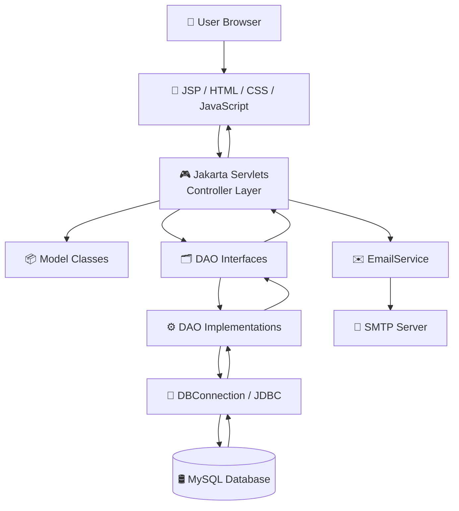
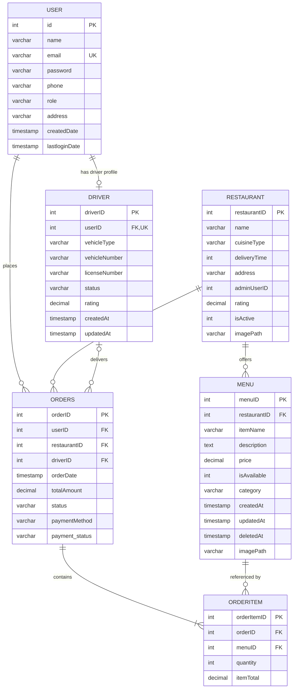

<div align="center">

# ⚡ FoodRush

### A Java EE Online Food Ordering & Delivery Management Platform

**Discover restaurants. Order your favourites. Track deliveries. Manage operations.**

<br/>


<br/>

**FoodRush** is a full-stack food ordering web application built with Java, Jakarta Servlets, JSP, JDBC, and MySQL. It provides separate workflows for customers, administrators, and delivery drivers through a structured MVC-style architecture.

</div>

---

## 📌 Table of Contents

- [Overview](#-overview)
- [Features](#-features)
- [Technology Stack](#-technology-stack)
- [Application Architecture](#-application-architecture)
- [Project Structure](#-project-structure)
- [Database Design](#-database-design)
- [Entity Relationship Diagram](#-entity-relationship-diagram)
- [Database Relationships](#-database-relationships)
- [Getting Started](#-getting-started)
- [Configuration](#-configuration)
- [Run the Application](#-run-the-application)
- [Application Routes](#-application-routes)
- [Security Notes](#-security-notes)
- [Future Improvements](#-future-improvements)
- [Author](#-author)

---

## 🚀 Overview

FoodRush is designed to bring the core operations of an online food delivery platform into one web application.

Customers can browse restaurants, explore menus, manage a cart, place orders, and view order progress. Administrators can manage platform data and orders. Delivery drivers have a dedicated dashboard for handling assigned deliveries and updating delivery statuses.

The application uses **JSP for the presentation layer**, **Jakarta Servlets for request handling**, **DAO classes for database operations**, and **MySQL for persistent storage**.

## ✨ Features

### 🛍️ Customer Module

- Browse restaurants and explore available menus.
- Search and filter restaurants and menu items.
- Add items to the shopping cart and update quantities.
- Review the cart and proceed through checkout.
- Place food orders and view order history.
- View order status and delivery information.
- Manage profile details.
- Recover account access through email OTP functionality.

### 🛠️ Admin Module

- View the admin dashboard and order statistics.
- Manage restaurant records.
- Add, update, and manage menu items.
- View and manage customer accounts.
- Review incoming orders and update order statuses.
- Assign available delivery drivers to orders.

### 🛵 Driver Module

- Access a dedicated driver dashboard.
- View assigned delivery tasks.
- Accept and update delivery progress.
- Move deliveries through the supported status workflow.
- View delivery information and customer contact details.

### 🔐 Account and Application Features

- Login and logout workflows.
- Role-based access for `CUSTOMER`, `ADMIN`, and `DRIVER`.
- Password hashing support through the included BCrypt library.
- Email-based OTP password recovery.
- Responsive JSP, CSS, and JavaScript user interface.
- MySQL relational database with primary keys, foreign keys, and indexes.

---

## 🧰 Technology Stack

| Layer | Technologies |
|---|---|
| Language | Java 21 (Docker build configuration) |
| Web framework/API | Jakarta Servlet API 5.0 |
| View technology | JSP, HTML5 |
| Styling | CSS3 |
| Client-side scripting | Vanilla JavaScript |
| Database | MySQL 8.0+ |
| Database connectivity | JDBC, MySQL Connector/J |
| Data access pattern | DAO and DAO Implementation |
| Application server | Apache Tomcat 10.1 |
| Email | Jakarta Mail, SMTP |
| Password hashing library | jBCrypt |
| Development IDE | Eclipse IDE for Enterprise Java |
| Containerization | Docker |

---

## 🏗️ Application Architecture

FoodRush follows a layered MVC-style structure. A browser request is received by a Servlet, the Servlet coordinates with DAO classes, and the DAO layer communicates with MySQL through JDBC.



### Request Flow

1. A user opens a page or submits a form from the browser.
2. A mapped Jakarta Servlet receives the HTTP request.
3. The Servlet validates input and applies the required application logic.
4. The Servlet calls the relevant DAO interface.
5. The DAO implementation executes SQL through JDBC.
6. The result is returned to the Servlet.
7. The Servlet forwards or redirects the user to the appropriate JSP page.

### Main Layers

| Layer | Responsibility | Project location |
|---|---|---|
| Presentation | Displays pages and handles browser interactions | `src/main/webapp/frontend/` |
| Controller | Handles HTTP requests and application workflows | `controller/` |
| Model | Holds application data | `model/` |
| DAO | Defines database operation contracts | `DAO/` |
| DAO Implementation | Contains JDBC and SQL operations | `DAOImpl/` |
| Utility | Database connection and email services | `util/` |
| Database | Stores application records and relationships | `database/` |

---

## 📂 Project Structure

The following tree represents the main source files and folders in the project. Generated class files, IDE metadata, and third-party package contents are intentionally omitted.

```text
JEE/
│
├── database/
│   ├── foodrush_schema.sql
│   ├── foodrush_seed_data.sql
│   ├── add_driver_support.sql
│   └── README.md
│
├── src/
│   └── main/
│       │
│       ├── java/
│       │   └── com/
│       │       └── foodRush/
│       │           │
│       │           ├── controller/
│       │           │   ├── HomeServlet.java
│       │           │   ├── LoginServlet.java
│       │           │   ├── LogoutServlet.java
│       │           │   ├── ForgotPasswordServlet.java
│       │           │   ├── RestaurantServlet.java
│       │           │   ├── MenuServlet.java
│       │           │   ├── CartServlet.java
│       │           │   ├── CheckoutServlet.java
│       │           │   ├── OrderServlet.java
│       │           │   ├── ProfileServlet.java
│       │           │   ├── DriverServlet.java
│       │           │   └── Admin*.java
│       │           │
│       │           ├── DAO/
│       │           │   ├── UserDAO.java
│       │           │   ├── RestaurantDAO.java
│       │           │   ├── MenuDAO.java
│       │           │   ├── OrderDAO.java
│       │           │   ├── OrderItemDAO.java
│       │           │   └── DriverDAO.java
│       │           │
│       │           ├── DAOImpl/
│       │           │   ├── UserDAOImpl.java
│       │           │   ├── RestaurantDAOImpl.java
│       │           │   ├── MenuDAOImpl.java
│       │           │   ├── OrderDAOImpl.java
│       │           │   ├── OrderItemDAOImpl.java
│       │           │   └── DriverDAOImpl.java
│       │           │
│       │           ├── model/
│       │           │   ├── User.java
│       │           │   ├── Restaurant.java
│       │           │   ├── Menu.java
│       │           │   ├── Driver.java
│       │           │   ├── Orders.java
│       │           │   ├── OrderItem.java
│       │           │   ├── Cart.java
│       │           │   └── CartItem.java
│       │           │
│       │           └── util/
│       │               ├── DBConnection.java
│       │               └── EmailService.java
│       │
│       ├── resources/
│       │   ├── db.properties.example
│       │   └── email.properties.example
│       │
│       └── webapp/
│           ├── WEB-INF/
│           │   ├── web.xml
│           │   └── lib/
│           │
│           └── frontend/
│               ├── index.jsp
│               ├── login.jsp
│               ├── restaurants.jsp
│               ├── menu.jsp
│               ├── cart.jsp
│               ├── checkout.jsp
│               ├── orders.jsp
│               ├── order-tracking.jsp
│               ├── profile.jsp
│               ├── admin-dashboard.jsp
│               ├── admin-menu.jsp
│               ├── admin-orders.jsp
│               ├── admin-restaurants.jsp
│               ├── admin-users.jsp
│               ├── driver-dashboard.jsp
│               ├── css/
│               ├── js/
│               ├── public/
│               └── error/
│
├── FoodRush_ER_Diagram.png
├── FoodRush_ER_Diagram.svg
├── FoodRush_ER_Diagram.html
├── Dockerfile
├── .gitignore
└── README.md
```

### Important Packages

- **`controller`**: Handles customer, admin, driver, authentication, cart, checkout, and order-related HTTP requests.
- **`DAO`**: Declares database operation methods.
- **`DAOImpl`**: Implements the DAO contracts using JDBC and SQL.
- **`model`**: Contains Java objects representing users, restaurants, menus, drivers, orders, and cart data.
- **`util`**: Provides shared services such as database connectivity and email delivery.

---

## 🗄️ Database Design

**Database name:** `foodrush_db`  
**Database engine:** InnoDB  
**Character set:** `utf8mb4`

FoodRush uses six core relational tables.

| Table | Purpose | Primary key |
|---|---|---|
| `user` | Stores customer, administrator, and driver account details | `id` |
| `restaurant` | Stores restaurant information | `restaurantID` |
| `menu` | Stores restaurant menu items | `menuID` |
| `driver` | Stores delivery partner and vehicle information | `driverID` |
| `orders` | Stores customer orders and delivery assignment | `orderID` |
| `orderitem` | Stores individual menu items belonging to an order | `orderItemID` |

### Entity Overview

<details>
<summary><strong>👤 USER</strong></summary>

| Column | Description |
|---|---|
| `id` | Primary key, auto increment |
| `name` | User's name |
| `email` | Unique email address |
| `password` | Password hash |
| `phone` | Contact number |
| `role` | CUSTOMER, ADMIN, or DRIVER |
| `address` | Delivery or user address |
| `createdDate` | Account creation timestamp |
| `lastloginDate` | Last login timestamp |

</details>

<details>
<summary><strong>🍽️ RESTAURANT</strong></summary>

| Column | Description |
|---|---|
| `restaurantID` | Primary key |
| `name` | Restaurant name |
| `cuisineType` | Cuisine category |
| `deliveryTime` | Estimated delivery time |
| `address` | Restaurant address |
| `adminUserID` | Admin reference field in the schema |
| `rating` | Restaurant rating |
| `isActive` | Restaurant availability flag |
| `imagePath` | Restaurant image path or URL |

</details>

<details>
<summary><strong>📋 MENU</strong></summary>

| Column | Description |
|---|---|
| `menuID` | Primary key |
| `restaurantID` | Foreign key referencing `restaurant` |
| `itemName` | Food item name |
| `description` | Item description |
| `price` | Item price |
| `isAvailable` | Availability flag |
| `category` | Food category |
| `createdAt` | Creation timestamp |
| `updatedAt` | Last update timestamp |
| `deletedAt` | Soft-delete timestamp |
| `imagePath` | Food image path or URL |

</details>

<details>
<summary><strong>🛵 DRIVER</strong></summary>

| Column | Description |
|---|---|
| `driverID` | Primary key |
| `userID` | Unique foreign key referencing `user.id` |
| `vehicleType` | Vehicle type |
| `vehicleNumber` | Vehicle registration number |
| `licenseNumber` | Driving license number |
| `status` | AVAILABLE, BUSY, or OFFLINE |
| `rating` | Driver rating |
| `createdAt` | Creation timestamp |
| `updatedAt` | Last update timestamp |

</details>

<details>
<summary><strong>🧾 ORDERS</strong></summary>

| Column | Description |
|---|---|
| `orderID` | Primary key |
| `userID` | Foreign key referencing `user.id` |
| `restaurantID` | Foreign key referencing `restaurant.restaurantID` |
| `driverID` | Nullable foreign key referencing `driver.driverID` |
| `orderDate` | Order creation timestamp |
| `totalAmount` | Total order amount |
| `status` | Order status |
| `paymentMethod` | Payment method |
| `payment_status` | Payment status |

</details>

<details>
<summary><strong>📦 ORDERITEM</strong></summary>

| Column | Description |
|---|---|
| `orderItemID` | Primary key |
| `orderID` | Foreign key referencing `orders.orderID` |
| `menuID` | Foreign key referencing `menu.menuID` |
| `quantity` | Quantity ordered |
| `itemTotal` | Total amount for this line item |

</details>

---

## 🔗 Entity Relationship Diagram

The ER diagram below represents the relationships defined by the foreign keys in `database/foodrush_schema.sql`.

### ER Diagram Image


> If GitHub does not render the image in your repository, confirm that `FoodRush_ER_Diagram.png` is present in the same directory as this README. The SVG version is also included in the project.

### ER Diagram Source (Mermaid)



### Relationship Explanation

| Relationship | Cardinality | Explanation |
|---|---|---|
| USER → DRIVER | 1 : 0..1 | A user can have one driver profile. A driver profile belongs to one user. |
| USER → ORDERS | 1 : Many | One customer can place multiple orders. |
| RESTAURANT → MENU | 1 : Many | One restaurant can offer multiple menu items. |
| RESTAURANT → ORDERS | 1 : Many | One restaurant can receive multiple orders. |
| DRIVER → ORDERS | 1 : Many | A driver can be assigned multiple orders over time. An order can have no driver until assigned. |
| ORDERS → ORDERITEM | 1 : Many | One order contains one or more order items. |
| MENU → ORDERITEM | 1 : Many | A menu item can appear in multiple order items. |

**Important schema note:** `restaurant.adminUserID` exists as a column, but the supplied schema does not declare it as a foreign key. The ER diagram therefore does not show a formal relationship between `user` and `restaurant` through this field.

---

## ⚙️ Getting Started

### Prerequisites

Install the following before running the project:

- Java Development Kit (JDK) 21
- MySQL Server 8.0 or later
- Apache Tomcat 10.1
- Eclipse IDE for Enterprise Java and Web Developers
- MySQL Workbench (recommended)
- Git (optional)

### 1. Clone the Repository

```bash
git clone <YOUR_FOODRUSH_REPOSITORY_URL>
```

Replace the placeholder with the actual Git repository URL. Alternatively, download the project and extract the `JEE` folder.

### 2. Create the Database

Open MySQL Workbench or the MySQL command line and execute:

```sql
CREATE DATABASE IF NOT EXISTS foodrush_db
CHARACTER SET utf8mb4
COLLATE utf8mb4_unicode_ci;
```

Select the `JEE` project directory in your terminal, then import the schema:

```bash
mysql -u root -p < database/foodrush_schema.sql
```

Import sample data:

```bash
mysql -u root -p foodrush_db < database/foodrush_seed_data.sql
```

The main schema already defines the `driver` table and the nullable `orders.driverID` foreign key. **Do not run `add_driver_support.sql` on a database created from the current schema**, because it attempts to add those structures again. That migration is intended for an older database that does not yet have driver support.

### 3. Configure Database Connection

The application reads database settings from `db.properties` and supports environment-variable overrides.

Create a local configuration file by copying the example:

```text
src/main/resources/db.properties.example
```

Rename the copy to:

```text
src/main/resources/db.properties
```

Update the values:

```properties
db.url=jdbc:mysql://localhost:3306/foodrush_db?useSSL=false&allowPublicKeyRetrieval=true&serverTimezone=UTC
db.user=root
db.password=YOUR_MYSQL_PASSWORD
```

Do not commit your real database password.

### 4. Configure Email (Optional)

For password-reset OTP emails, copy:

```text
src/main/resources/email.properties.example
```

Rename it to:

```text
src/main/resources/email.properties
```

Configure your SMTP account:

```properties
mail.smtp.host=smtp.gmail.com
mail.smtp.port=587
mail.smtp.auth=true
mail.smtp.starttls.enable=true
mail.from.name=FoodRush Security
mail.user=your_email@gmail.com
mail.password=your_google_app_password
```

Use a Google App Password, not your normal Google account password. Keep this file private.

---

## ▶️ Run the Application

### Option A: Eclipse + Apache Tomcat

1. Open Eclipse IDE.
2. Select **File → Import → Existing Projects into Workspace**.
3. Choose the extracted `JEE` project directory.
4. Configure Apache Tomcat 10.1 in Eclipse under **Window → Preferences → Server → Runtime Environments**.
5. Add the FoodRush project to the Tomcat server.
6. Ensure MySQL is running and the database has been imported.
7. Start the Tomcat server.
8. Open the application:

```text
http://localhost:8080/JEE/home
```

The exact context path depends on the deployed application name. If the project is deployed as the Tomcat ROOT application, use:

```text
http://localhost:8080/home
```

### Option B: Docker

The repository includes a Dockerfile that builds the Java application with a Tomcat 10.1 / JDK 21 base image.

Build the image from the `JEE` directory:

```bash
docker build -t foodrush .
```

Run the container:

```bash
docker run -p 8080:8080 \
  -e DB_URL="jdbc:mysql://YOUR_DB_HOST:3306/foodrush_db?useSSL=false&allowPublicKeyRetrieval=true&serverTimezone=UTC" \
  -e DB_USER="YOUR_DB_USER" \
  -e DB_PASSWORD="YOUR_DB_PASSWORD" \
  foodrush
```

The database host must be reachable from inside the container. `localhost` inside a container refers to the container itself, not your host machine.

Open:

```text
http://localhost:8080/home
```

---

## 🌐 Application Routes

The project uses `@WebServlet` annotations for its Servlet mappings. The following are route groups based on the controller responsibilities; confirm exact URL patterns in each Servlet before using them as API documentation.

| Module | Controller examples | Responsibility |
|---|---|---|
| Home | `HomeServlet` | Landing page and home content |
| Authentication | `LoginServlet`, `LogoutServlet`, `ForgotPasswordServlet` | Login, logout, password recovery |
| Restaurants | `RestaurantServlet` | Restaurant listing and details |
| Menu | `MenuServlet` | Menu browsing |
| Cart | `CartServlet` | Cart operations |
| Checkout | `CheckoutServlet` | Order checkout |
| Orders | `OrderServlet` | Order history and order operations |
| Profile | `ProfileServlet` | User profile |
| Driver | `DriverServlet` | Driver delivery workflow |
| Admin | `AdminDashboardServlet`, `AdminMenuServlet`, `AdminOrderServlet`, `AdminRestaurantServlet`, `AdminUserServlet` | Administrative operations |

---

## 🔐 Security Notes

- Never commit `db.properties`, `email.properties`, passwords, API keys, or other secrets.
- Store production credentials in environment variables or a secure secret manager.
- Use hashed passwords. Never store plain-text passwords.
- Validate and authorize every protected request on the server side.
- Use HTTPS in production.
- Review error messages and logs to ensure they do not expose credentials or sensitive data.

**Before publishing this repository:** inspect the source code and Git history for credentials. Remove hardcoded SMTP/database credentials, rotate any credentials that have been exposed, and remove sensitive files from the repository history where necessary. A `.gitignore` rule does not remove secrets that were already committed.

---

## 🧭 Future Improvements

Potential enhancements for a production-ready platform:

- Integrate a payment gateway.
- Add automated order notifications.
- Add stronger order tracking and delivery location updates.
- Add unit and integration tests.
- Introduce a service layer between Servlets and DAO implementations.
- Add centralized validation and exception handling.
- Add pagination and more advanced search filters.
- Improve deployment configuration and secret management.

---

## 👨‍💻 Author

**Lokesh**  
GitHub: [@Lokesh-0009](https://github.com/Lokesh-0009)

**Project:** FoodRush – Online Food Ordering & Delivery Management Platform

---

<div align="center">

### ⚡ FoodRush

**Good food. Simple ordering. Reliable delivery.**

<sub>Built with Java • Jakarta Servlets • JSP • JDBC • MySQL</sub>

</div>
