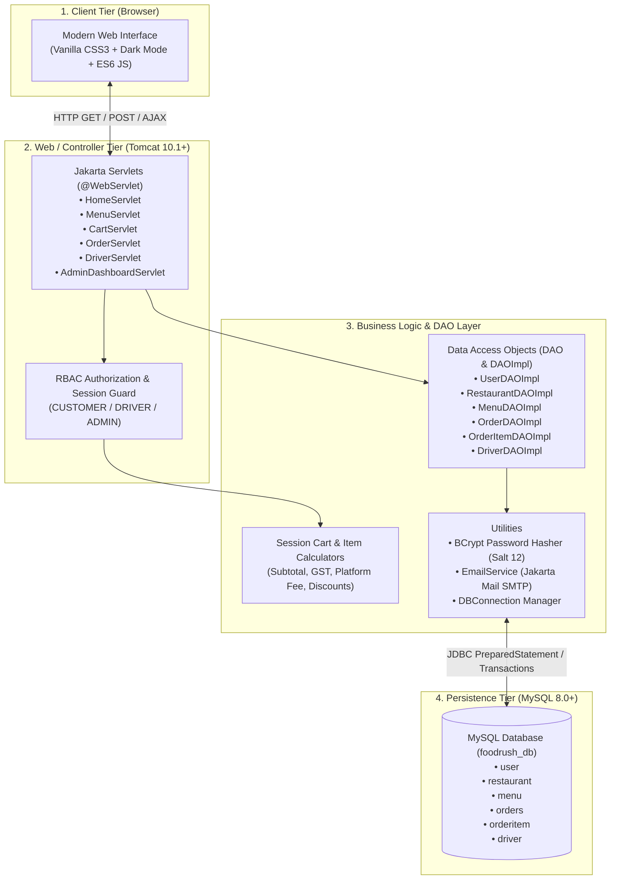
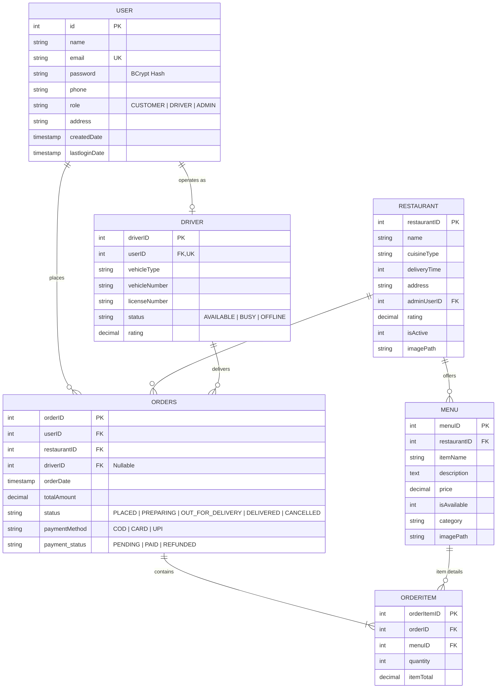
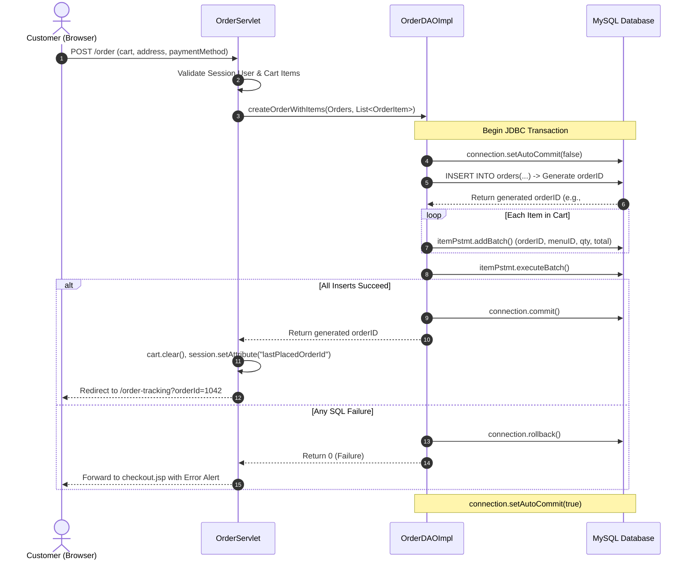
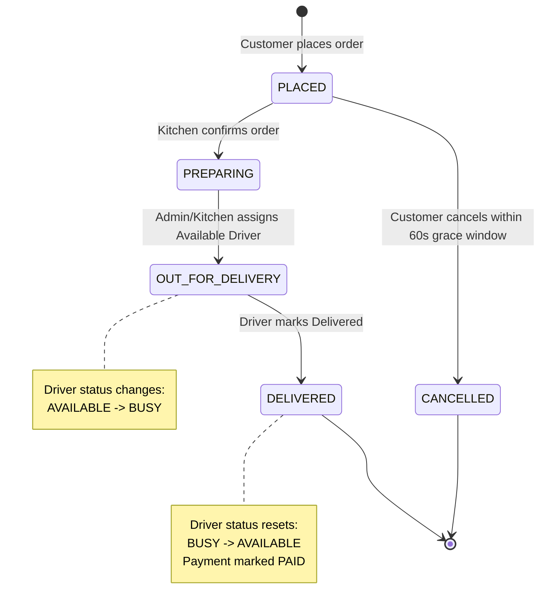

# FoodRush — Technical Presentation & Defense Guide
> **Enterprise Online Food Ordering, Kitchen Dispatch & Logistics Platform**  
> *Built with Java EE (Jakarta Servlets & JSP), MySQL, Modern Vanilla CSS3 Design System, BCrypt Authentication & Jakarta Mail.*

---

## Table of Contents
1. [Executive Summary & Project Overview](#1-executive-summary--project-overview)
2. [High-Level Architecture (3-Tier MVC)](#2-high-level-architecture-3-tier-mvc)
3. [Database Entity-Relationship (ER) Architecture](#3-database-entity-relationship-er-architecture)
4. [Core Business Workflows & State Machines](#4-core-business-workflows--state-machines)
   - [A. Order Placement & ACID Transaction Flow](#a-order-placement--acid-transaction-flow)
   - [B. Multi-Restaurant Cart Conflict Resolution](#b-multi-restaurant-cart-conflict-resolution)
   - [C. Driver Dispatch & Order Lifecycle State Machine](#c-driver-dispatch--order-lifecycle-state-machine)
   - [D. BCrypt Security & OTP Password Recovery](#d-bcrypt-security--otp-password-recovery)
5. [Minute-by-Minute Presentation Speech Script (10-Min Pitch)](#5-minute-by-minute-presentation-speech-script-10-min-pitch)
6. [Live Demonstration Flow (Zero-Error Walkthrough)](#6-live-demonstration-flow-zero-error-walkthrough)
7. [Expected Questions from Judges & Model Defense Answers](#7-expected-questions-from-judges--model-defense-answers)
   - [Category 1: Java EE & Architecture Patterns](#category-1-java-ee--architecture-patterns)
   - [Category 2: Database, Concurrency & ACID Transactions](#category-2-database-concurrency--acid-transactions)
   - [Category 3: Security, Authentication & Session Handling](#category-3-security-authentication--session-handling)
   - [Category 4: Frontend Engineering & Performance](#category-4-frontend-engineering--performance)
   - [Category 5: Scalability & Future Architecture Evolution](#category-5-scalability--future-architecture-evolution)
8. [Quick Reference Cheat Sheet for the Presenter](#8-quick-reference-cheat-sheet-for-the-presenter)

---

## 1. Executive Summary & Project Overview

### What is FoodRush?
**FoodRush** is a full-featured, enterprise-grade food ordering and delivery management system modeled after real-world platforms like Swiggy and Zomato. Unlike standard academic CRUD apps, FoodRush orchestrates a **tri-directional ecosystem**:
1. **The Customer:** Explores multi-cuisine restaurants, builds session-managed carts, handles cross-restaurant conflicts, places orders with atomic database transactions, and tracks order progress with a live countdown and cancellation window.
2. **The Kitchen / Admin Manager:** Monitors live incoming orders through a real-time **4-stage Kanban kitchen board** (*Placed -> Preparing -> Out for Delivery -> Delivered*), manages restaurant catalogs/menus, and dispatches orders to delivery partners.
3. **The Delivery Driver:** Manages active orders on a dedicated driver portal, toggles availability (*AVAILABLE / BUSY*), views customer contacts/addresses, and drives status transitions until final drop-off.

### Tech Stack Snapshot
| Layer | Technologies Used |
| :--- | :--- |
| **Presentation (View)** | JSP (JavaServer Pages), Modern Vanilla CSS3 (Custom Design System, HSL Tokens, Dark/Light Mode), Vanilla ES6 JavaScript, FontAwesome 6 |
| **Controller (Servlet)** | Jakarta Servlet 5.0 / 6.0, HTTP Session Management, URL Mapping (`@WebServlet`), Request Dispatcher |
| **Business & Data Access** | DAO (Data Access Object) Pattern, Plain Old Java Objects (POJOs), JDBC (`PreparedStatement`, Batch Updates) |
| **Database (Persistence)** | MySQL 8.0+ / 9.0 (InnoDB Engine, Foreign Keys, Indexing, Transactions) |
| **Security & Services** | jBCrypt (12-round salted hashing), Jakarta Mail 2.0.1 (SMTP OTP delivery), RBAC Security Filters |
| **Container & Runtime** | Apache Tomcat 10.1+, Java Development Kit (JDK 21) |

---

## 2. High-Level Architecture (3-Tier MVC)

The application adheres strictly to the **Model-View-Controller (MVC)** and **DAO Design Pattern** to ensure strict separation of concerns, maintainability, and scalability.



---

## 3. Database Entity-Relationship (ER) Architecture

The relational schema implements normalization (3NF) with foreign key constraints, cascading deletions where appropriate, and indexed lookup columns.



---

## 4. Core Business Workflows & State Machines

### A. Order Placement & ACID Transaction Flow
Placing an order is an atomic operation requiring simultaneous creation of the master `orders` record and batch insertion of multiple child `orderitem` records.



---

### B. Multi-Restaurant Cart Conflict Resolution
Just like Swiggy and Zomato, FoodRush enforces single-restaurant cart integrity while providing a seamless user prompt when an item from a different restaurant is added.

```mermaid
flowchart TD
    Start([User clicks 'Add to Cart']) --> CheckCart{Is Cart Empty?}
    CheckCart -- Yes --> AddDirect[Add Item & Assign RestaurantID to Cart]
    CheckCart -- No --> CheckResID{Item RestaurantID == Cart RestaurantID?}
    CheckResID -- Yes --> AddQuantity[Increment Item Quantity / Add Dish]
    CheckResID -- No --> ShowModal[Trigger Conflict Resolution Modal]

    ShowModal --> UserChoice{User Selection}
    UserChoice -- 'Keep Existing' --> Dismiss[Dismiss Modal & Keep Current Cart]
    UserChoice -- 'Discard & Add' --> ResetCart[Cart.clear() -> Reset RestaurantID -> Add New Item]

    AddDirect --> UpdateUI[Update Badge Count & Drawer via AJAX JSON]
    AddQuantity --> UpdateUI
    ResetCart --> UpdateUI
```

---

### C. Driver Dispatch & Order Lifecycle State Machine
Orders transition across distinct milestones, with driver statuses automatically synchronized.



---

### D. BCrypt Security & OTP Password Recovery

```mermaid
flowchart TD
    subgraph Auth ["Authentication Flow"]
        InputPass["Raw Password Input"] --> CheckHash{"Is DB Password BCrypt?"}
        CheckHash -- Yes ($2a$...) --> BCryptCheck["BCrypt.checkpw(raw, hash)"]
        CheckHash -- No (Plaintext Legacy) --> PlainCheck{"raw.equals(dbPassword)"}
        PlainCheck -- Match --> Upgrade["Auto-Upgrade: hashpw(raw, gensalt(12)) & UPDATE DB"]
        PlainCheck -- Fail --> Deny["Login Denied"]
        BCryptCheck -- Match --> Grant["Create Authenticated Session"]
        BCryptCheck -- Fail --> Deny
    end

    subgraph OTPRecovery ["6-Digit OTP Recovery"]
        Forgot["User Enters Registered Email"] --> Lookup{"User Exists?"}
        Lookup -- Yes --> GenOTP["Generate Secure 6-Digit OTP\n(Valid for 10 Mins in Session)"]
        GenOTP --> TryMail{"Jakarta Mail SMTP Configured?"}
        TryMail -- Yes --> SendMail["Send HTML Email via Gmail SMTP"]
        TryMail -- No --> Fallback["Log OTP / Demo Mode Fallback Response"]
        SendMail --> VerifyOTP["User Submits OTP + New Password"]
        Fallback --> VerifyOTP
        VerifyOTP --> ValidCheck{"OTP Matches & Within 10m?"}
        ValidCheck -- Yes --> HashNew["BCrypt.hashpw(newPassword, gensalt(12)) -> Save"]
        ValidCheck -- No --> OTPError["Display Invalid/Expired Code Error"]
    end
```



---

## 5. Minute-by-Minute Presentation Speech Script (10-Min Pitch)

| Timeline | Presentation Phase | What to Say (Verbatim Guide) | Screen / Visual to Show |
| :--- | :--- | :--- | :--- |
| **0:00 - 1:00** | **Hook & Problem Statement** | *"Good morning respected judges. Online food ordering systems today demand high concurrency, multi-stakeholder orchestration, and zero data inconsistency. Today, I am proud to present **FoodRush** — an enterprise-grade food ordering and delivery logistics management system built entirely on Jakarta Servlets, JSP, MySQL, and modern Vanilla CSS. FoodRush connects three critical actors into one seamless loop: the Customer, the Kitchen Manager, and the Delivery Rider."* | Title Slide / FoodRush Home Page (`/home`) |
| **1:00 - 2:30** | **Architecture Overview** | *"Before demonstrating the live application, let's look at the underlying architecture. We adopted a strict **3-Tier MVC pattern**. The presentation tier uses pure Vanilla CSS3 with dynamic light/dark theming and asynchronous AJAX micro-interactions. The controller tier is powered by Jakarta Servlets handling role-based routing and session state. The data layer utilizes the **DAO Design Pattern** with pure JDBC, ensuring clean separation of database queries from business rules."* | Show [System Architecture Diagram](#2-high-level-architecture-3-tier-mvc) and [Database ER Diagram](#3-database-entity-relationship-er-architecture) |
| **2:30 - 4:30** | **Customer Experience Demo** | *"Let's experience the customer journey. On the homepage, users can filter by cuisine or search dishes in real time. Notice our **Cart Conflict Engine**: if I add a Biryani from 'Meghana Foods' and then try to add a Pizza from 'Toscano', the system detects the restaurant mismatch and asks if I want to reset my cart. At checkout, after selecting Cash on Delivery or Card, our backend executes an **atomic JDBC transaction**: inserting the master order and batch-inserting each item. Notice the live order tracking screen with a dynamic progress bar and a 60-second grace cancellation window."* | Live browser demo: Add to cart, trigger conflict modal, checkout, view `/order-tracking` |
| **4:30 - 6:00** | **Kitchen & Dispatch Board** | *"Now let's switch hats to the **Admin & Kitchen Operations Suite**. Kitchen staff monitor all orders on an interactive **Kanban Board** categorized into Placed, Preparing, Out for Delivery, and Delivered. Here, the kitchen manager selects an available delivery rider and assigns them with one click. The database immediately updates the order status to OUT_FOR_DELIVERY and transitions the driver's state from AVAILABLE to BUSY."* | Navigate to `/admin/orders` (Kanban board) and assign a driver |
| **6:00 - 7:15** | **Driver Portal Experience** | *"Now looking at the third actor: the **Delivery Rider**. Logging into `/driver/dashboard`, the driver sees their active assignment, customer phone number, drop-off address, and earnings summary. As soon as the driver marks the order as 'DELIVERED', two things happen in our backend: the order is marked completed, and the driver's status automatically resets back to 'AVAILABLE' to accept new deliveries."* | Navigate to `/driver/dashboard` and update delivery status |
| **7:15 - 8:30** | **Engineering & Security Deep-Dive** | *"Under the hood, security and data integrity were our top engineering priorities. First, we implemented **BCrypt password hashing** with 12 salt rounds. We even wrote a self-healing migration mechanism: if a legacy user logs in with plaintext credentials, the system verifies and transparently re-hashes their password in the database. Second, password recovery is protected via **Jakarta Mail 6-digit OTP verification** with a 10-minute expiry. Third, all SQL queries use parameterized `PreparedStatement` preventing SQL injection."* | Highlight code in `LoginServlet.java` (BCrypt) and `OrderDAOImpl.java` (Transaction) |
| **8:30 - 10:00** | **Conclusion & Q&A Opening** | *"In summary, FoodRush demonstrates that core Java EE technologies, when engineered with modern architectural design patterns and aesthetic design systems, can deliver a production-ready, highly responsive web platform. Thank you, and I am now ready for your questions."* | Open Q&A Slide with GitHub repo link |

---

## 6. Live Demonstration Flow (Zero-Error Walkthrough)

To ensure a seamless, crash-free demo in front of the judges, follow this exact sequence:

1. **Pre-Demo Sanity Check:**
   - MySQL service is running (`foodrush_db`).
   - Tomcat 10.1 is launched on `localhost:8080`.
   - Open browser to `http://localhost:8080/JEE/home`.
2. **Demo Step 1: Customer Browse & Cart Conflict**
   - Click on **"Meghana Foods"** -> Add 1 *Boneless Chicken Biryani* to cart.
   - Go back to restaurants -> Open **"Toscano"** -> Click *Add to Cart* on a Pasta dish.
   - **Showcase:** Point out the **Restaurant Conflict Modal** ("Your cart contains items from Meghana Foods..."). Click **"Replace Cart Items"**.
3. **Demo Step 2: Checkout & Order Placement**
   - Click cart drawer -> Proceed to Checkout.
   - Use the **1-Click Customer Demo Fill** button or log in as `amitabh.sen@gmail.com` / `pass1234`.
   - Select payment method (e.g., Cash on Delivery) -> Click **"Place Order"**.
   - **Showcase:** Note the generated Order ID (e.g., `#ORD-1045`) and the 60-second cancellation timer.
4. **Demo Step 3: Admin Kitchen Dispatch**
   - Open incognito window or log in as Admin: `admin@foodrush.com` / `admin@123`.
   - Go to `/admin/orders`.
   - Locate the newly placed order in the **"Pending / Placed"** column.
   - Select rider **"Ramesh Kumar (Bike)"** from the dropdown and click **"Assign Driver"**.
   - Notice the order moves to **"Out for Delivery"**.
5. **Demo Step 4: Driver Delivery Completion**
   - In another browser tab/profile, log in as Driver: `ramesh.driver@foodrush.com` / `driver@123`.
   - Visit `/driver/dashboard`.
   - Show the assigned active order, customer delivery address, and earnings.
   - Click **"Mark as Delivered"**.
   - Show how the customer order tracking page reflects **"Delivered"** upon refresh!

---

## 7. Expected Questions from Judges & Model Defense Answers

### Category 1: Java EE & Architecture Patterns

#### Q1: "Why did you build this using Servlets and JSP instead of Spring Boot?"
- **Judge's Intent:** Testing your foundational understanding of Java Enterprise Edition and whether you understand what frameworks abstract away.
- **Model Answer:**  
  *"Building FoodRush with raw Jakarta Servlets and JSP allowed us to master the core foundational mechanics of enterprise web architecture — such as request-response lifecycles, HTTP session management, servlet filters, connection lifecycle, and manual transaction management. While Spring Boot provides excellent rapid abstraction, building with core Java EE gave us granular control over every HTTP transaction and demonstrates in-depth mastery of the Servlet specification on Tomcat 10."*
- **Follow-up Defense:** Mention that the architecture is cleanly layered (Controller -> DAO -> Model), making it effortless to migrate to Spring Boot REST Controllers in the future.

---

#### Q2: "Explain the design patterns you have implemented in FoodRush."
- **Judge's Intent:** Verifying design pattern fluency.
- **Model Answer:**  
  1. **MVC (Model-View-Controller):** Servlets act as Controllers, JSPs as Views, and Java classes (`Orders`, `Cart`, `User`) as Models.
  2. **DAO (Data Access Object) Pattern:** Clear separation of database persistence (`OrderDAO`, `RestaurantDAO`) from business controllers.
  3. **Singleton Pattern:** The `DBConnection` utility maintains a single configuration loader and centralizes connection acquisition.
  4. **State Pattern / State Machine:** Order progression (*PLACED -> PREPARING -> OUT_FOR_DELIVERY -> DELIVERED*) and Driver status (*AVAILABLE <-> BUSY*).
  5. **Composite / Aggregate Pattern:** The `Cart` class aggregates multiple `CartItem` objects and encapsulates financial calculation algorithms.

---

#### Q3: "Are Servlets thread-safe? How do you handle concurrency in your Servlets?"
- **Judge's Intent:** Testing core multithreading concepts in Java Servlets.
- **Model Answer:**  
  *"By default, the Servlet container creates a **single instance** of each Servlet and handles concurrent client requests across multiple worker threads calling `service()`, `doGet()`, or `doPost()`. Therefore, Servlets are **not inherently thread-safe if they contain mutable instance variables**.  
  In FoodRush, we ensure thread safety by:*
  - *Keeping Servlets stateless: DAOs and utility references initialized in `init()` are stateless or thread-safe.*
  - *Storing user-specific mutable state exclusively inside the `HttpSession` or local method variables on the thread stack.*
  - *Delegating all atomic data modifications to database transactions."*

---

### Category 2: Database, Concurrency & ACID Transactions

#### Q4: "How do you handle atomic transactions during order placement?"
- **Judge's Intent:** Checking understanding of ACID properties and database integrity.
- **Model Answer (Reference: [OrderDAOImpl.java](file:///c:/JavaSoftwares/javaWorkspaces/JEE_Workspace/JEE/src/main/java/com/foodRush/DAOImpl/OrderDAOImpl.java#L348-L395)):**  
  *"In `OrderDAOImpl.createOrderWithItems()`, we disable auto-commit using `connection.setAutoCommit(false)`. We first insert the master record into the `orders` table and retrieve the auto-generated primary key using `Statement.RETURN_GENERATED_KEYS`. Next, using the generated Order ID, we iterate through the cart items and batch-insert them into the `orderitem` table using `PreparedStatement.addBatch()` and `executeBatch()`.  
  If all operations succeed, we invoke `connection.commit()`. If any SQL exception occurs, we catch it and immediately invoke `connection.rollback()`. Finally, in the `finally` block, we reset `connection.setAutoCommit(true)` and close the connection. This guarantees full **Atomicity** — no partial orders or orphan items can ever exist in the database."*

---

#### Q5: "Why did you use JDBC Batching (`addBatch()`) instead of single inserts in a loop?"
- **Judge's Intent:** Evaluating your performance awareness for database network I/O.
- **Model Answer:**  
  *"Executing individual `executeUpdate()` statements inside a loop introduces substantial network latency because each query requires a separate round-trip to the MySQL server. With `addBatch()` and `executeBatch()`, the JDBC driver bundles all order item inserts into a single network transmission packet, significantly reducing database I/O, server CPU overhead, and execution time."*

---

#### Q6: "What happens if two drivers try to accept the same order simultaneously?"
- **Judge's Intent:** Testing race condition handling.
- **Model Answer:**  
  *"In our current architecture, driver assignment is centralized through the Admin dispatch board, preventing simultaneous claims. However, in a decentralized driver-acceptance model, we prevent race conditions at the database level using **optimistic locking** or an atomic conditional SQL update:*
  ```sql
  UPDATE orders SET driverID = ?, status = 'OUT_FOR_DELIVERY' 
  WHERE orderID = ? AND driverID IS NULL;
  ```
  *If the affected row count is 1, the driver successfully secured the order; if it returns 0, another driver claimed it first, and we return a user-friendly alert."*

---

### Category 3: Security, Authentication & Session Handling

#### Q7: "How do you protect user passwords, and why did you choose BCrypt over SHA-256 or MD5?"
- **Judge's Intent:** Testing cryptography and security best practices.
- **Model Answer (Reference: [LoginServlet.java](file:///c:/JavaSoftwares/javaWorkspaces/JEE_Workspace/JEE/src/main/java/com/foodRush/controller/LoginServlet.java#L127-L140)):**  
  *"We use **BCrypt** with 12 salt rounds via `jBCrypt`. SHA-256 and MD5 are general-purpose cryptographic hashing functions designed for speed; because they are fast, modern GPUs can compute billions of hashes per second, making them vulnerable to brute-force and rainbow table attacks.  
  BCrypt is an adaptive key-derivation function that incorporates a random 128-bit salt and a configurable work factor (computational cost). As hardware speeds up, we can increase the salt rounds to keep hashing computationally expensive for attackers while remaining imperceptible to legitimate users."*

---

#### Q8: "How does FoodRush defend against SQL Injection attacks?"
- **Judge's Intent:** Standard OWASP security verification.
- **Model Answer:**  
  *"Throughout our entire DAO layer (`UserDAOImpl`, `OrderDAOImpl`, `MenuDAOImpl`), we **never** concatenate user input directly into SQL strings. Every query uses parameterized `java.sql.PreparedStatement` with placeholder tokens (`?`). The database driver compiles the SQL execution plan first and treats supplied parameters purely as literal values, completely neutralizing SQL injection vectors."*

---

#### Q9: "How is Role-Based Access Control (RBAC) enforced?"
- **Judge's Intent:** Verifying authorization barriers between Customer, Driver, and Admin.
- **Model Answer:**  
  *"Every administrative and driver servlet implements an authorization guard (e.g., `isAuthorizedAdmin()` in `AdminDashboardServlet` and `isAuthorizedDriver()` in `DriverServlet`). The method validates the active `HttpSession`. If no session exists or if `user.getRole()` does not contain the required role privilege, the request is terminated immediately and redirected to the login endpoint with a return redirect parameter."*

---

### Category 4: Frontend Engineering & Performance

#### Q10: "Why did you use Vanilla CSS instead of Bootstrap or Tailwind?"
- **Judge's Intent:** Assessing frontend competency and design choices.
- **Model Answer:**  
  *"We deliberately created a custom **Vanilla CSS3 Design System** (`variables.css`, `components.css`, `global.css`) utilizing modern CSS Custom Properties (variables), CSS Grid, and Flexbox. This decision provided three major advantages:*
  1. **Zero External Overhead:** Eliminates bulky CSS framework payloads (over 300KB+ saved), resulting in near-instant page loads.
  2. **Seamless Dark/Light Theming:** By swapping CSS HSL variables on `:root` and `[data-theme='dark']`, the entire UI switches themes without reloading or flashing.
  3. **Complete Design Control:** Allows custom-tailored food-delivery components like restaurant badge overlays, custom quantity steppers, and animated order tracking timelines."*

---

#### Q11: "How does the Cart update dynamically without refreshing the entire page?"
- **Judge's Intent:** Checking AJAX / asynchronous web concepts.
- **Model Answer (Reference: [CartServlet.java](file:///c:/JavaSoftwares/javaWorkspaces/JEE_Workspace/JEE/src/main/java/com/foodRush/controller/CartServlet.java#L70-L128)):**  
  *"In `CartServlet`, we inspect the `X-Requested-With` header or `format=json` parameter. When an AJAX request is received from our client-side JavaScript (`fetch('/cart/add?format=json')`), the servlet executes the cart mutation and writes a structured JSON payload directly to `response.getWriter()` instead of forwarding to a JSP view. The frontend JavaScript parses the JSON response and updates the navbar badge, drawer subtotal, and tax breakdowns dynamically."*

---

### Category 5: Scalability & Future Architecture Evolution

#### Q12: "How would you scale FoodRush to handle 100,000 orders per day?"
- **Judge's Intent:** Gauging architectural vision and scalability thinking.
- **Model Answer:**  
  1. **Connection Pooling:** Replace `DriverManager.getConnection()` with a high-performance connection pool like **HikariCP** to reuse pre-allocated database connections.
  2. **Caching Layer:** Introduce **Redis** to cache frequently queried, read-heavy data like active restaurants, menu listings, and user session tokens.
  3. **Asynchronous Real-Time Communication:** Replace HTTP meta-refresh / polling on the order tracking and kitchen board with **WebSockets** or Server-Sent Events (SSE) for instant live push updates.
  4. **Microservices Decomposition:** Decouple the monolithic application into specialized services: *Order Service, Catalog Service, Payment Gateway Service, and Driver Tracking Service* communicating via an asynchronous message broker like Apache Kafka or RabbitMQ.

---

## 8. Quick Reference Cheat Sheet for the Presenter

### Demo Credentials Card
```text
Role       | Email                        | Password    | Destination
-----------+------------------------------+-------------+-------------------
Customer   | amitabh.sen@gmail.com        | pass1234    | /home
Driver     | ramesh.driver@foodrush.com   | driver@123  | /driver/dashboard
Admin      | admin@foodrush.com           | admin@123   | /admin/dashboard
```

### Key File Locations in the Codebase
- **Order Transaction Logic:** [`OrderDAOImpl.java`](file:///c:/JavaSoftwares/javaWorkspaces/JEE_Workspace/JEE/src/main/java/com/foodRush/DAOImpl/OrderDAOImpl.java#L348)
- **Cart Conflict Engine:** [`CartServlet.java`](file:///c:/JavaSoftwares/javaWorkspaces/JEE_Workspace/JEE/src/main/java/com/foodRush/controller/CartServlet.java#L151)
- **BCrypt Password Hashing & Upgrade:** [`LoginServlet.java`](file:///c:/JavaSoftwares/javaWorkspaces/JEE_Workspace/JEE/src/main/java/com/foodRush/controller/LoginServlet.java#L127)
- **Driver State Management:** [`DriverServlet.java`](file:///c:/JavaSoftwares/javaWorkspaces/JEE_Workspace/JEE/src/main/java/com/foodRush/controller/DriverServlet.java)
- **Kitchen Kanban Board:** [`AdminOrderServlet.java`](file:///c:/JavaSoftwares/javaWorkspaces/JEE_Workspace/JEE/src/main/java/com/foodRush/controller/AdminOrderServlet.java#L107)
- **OTP Verification & Email Service:** [`ForgotPasswordServlet.java`](file:///c:/JavaSoftwares/javaWorkspaces/JEE_Workspace/JEE/src/main/java/com/foodRush/controller/ForgotPasswordServlet.java) and [`EmailService.java`](file:///c:/JavaSoftwares/javaWorkspaces/JEE_Workspace/JEE/src/main/java/com/foodRush/util/EmailService.java)
- **Global Theme & Password Toggles:** [`global.js`](file:///c:/JavaSoftwares/javaWorkspaces/JEE_Workspace/JEE/src/main/webapp/frontend/js/global.js)

### Golden Rules for the Presentation:
1. **Speak with confidence:** You built a complete, production-grade 3-tier system with real business rules, not just a homework project.
2. **Control the pace:** Spend 20% on slides, 50% on live interactive demo, and 30% on code architecture and defense.
3. **If a question is tough:** Pause, acknowledge the concept, tie it back to your code structure, and explain how you would extend the platform.
